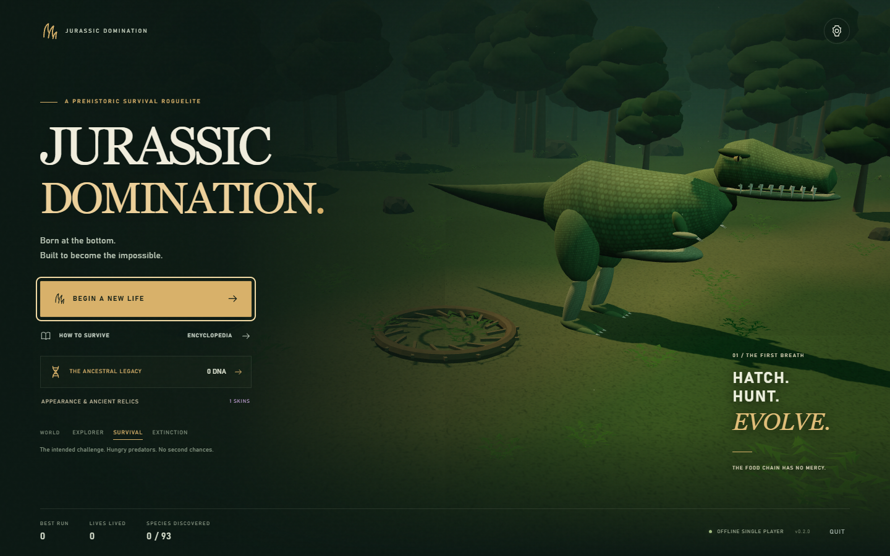
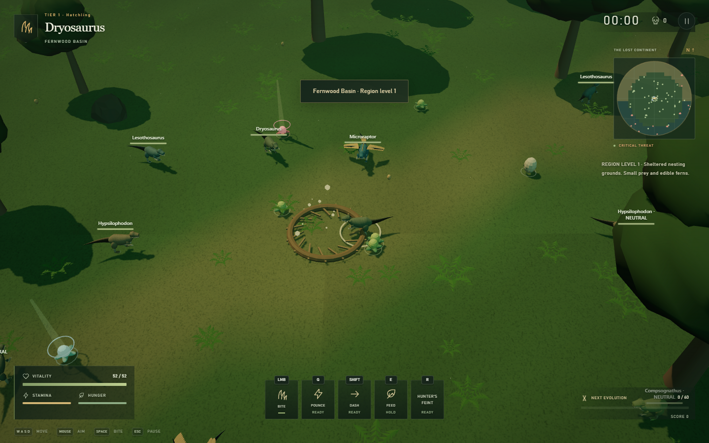
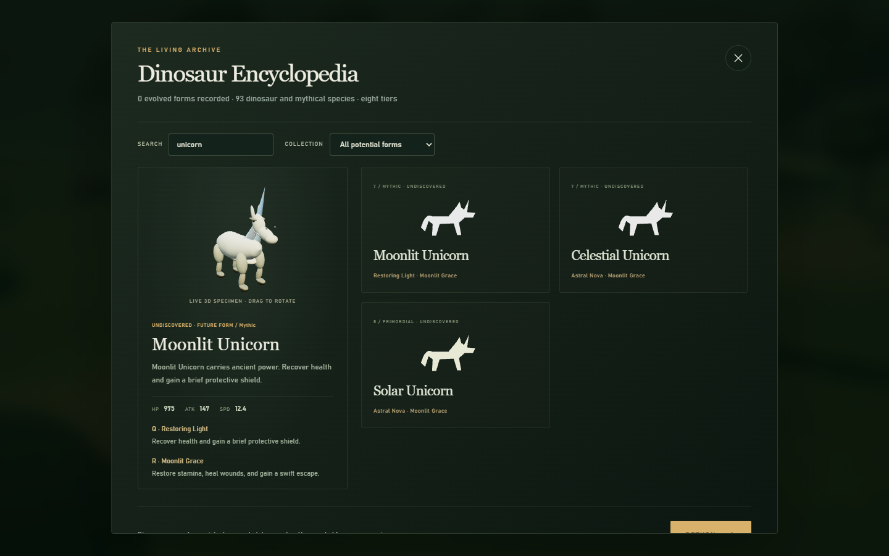

# Jurassic Domination

A single-player dinosaur survival roguelite. Crack your egg, hatch into a random
small dinosaur, hunt through a living prehistoric wilderness, and evolve into
larger predators and eventually mythological creatures. Death ends the run;
rare DNA funds your permanent collection and next generation.

This is an offline, playable desktop game built with Three.js and Electron. It
includes original procedural 3D creatures and environments, an adaptive musical
score, combat, evolution choices, persistent progression, and a complete menu
flow. It is a foundation for a future commercial release; it has not been
published on Steam or integrated with Steamworks.







## Play on Windows

From a packaged build, launch **Jurassic Domination.exe**. The unpacked version is
at `release/win-unpacked/Jurassic Domination.exe`; keep that entire folder
together. The portable build is `release/Jurassic Domination-0.5.0-portable.exe`.
An unsigned development build may trigger Windows SmartScreen. Obtain builds
from the project owner and sign the final commercial release.

In this workspace, you can also double-click **Play Jurassic Domination.cmd**.
Downloadable Windows builds are provided under this repository's GitHub Releases.

For a source checkout, install Node.js 24 LTS or newer, then run:

```powershell
npm ci
npm run build
npm run desktop
```

For browser development:

```powershell
npm run dev
```

Open the local address printed by Vite. Launching `index.html` directly from the
filesystem is not supported. A browser must support WebGL 2. Audio starts after
the first interaction, according to browser autoplay rules.

## Controls

| Action | Control |
| --- | --- |
| Move | WASD or arrow keys |
| Aim | Mouse position |
| Bite / primary attack | Left mouse button or Space |
| Species ability | Q |
| Species technique | R |
| Anatomy-specific extra skill, when available | X |
| Open ready evolution / postpone | T / Escape |
| Bloodline condition journal | J |
| Sprint | Hold Ctrl |
| Ancient relic skills, in discovery order | F, G, C, V, B, N |
| Dodge / dash, for mobile forms | Shift |
| Eat nearby food | E |
| Pause / back | Escape |
| Toggle fullscreen | F11, or the Settings button |
| Expand the map | M |
| Open the dinosaur encyclopedia | Tab |

The tutorial, live 3D encyclopedia, and appearance collection are available from the title screen. Watch the
cooldown indicators before committing to a fight. Dash consumes stamina and
provides a short window of protection. Eat regularly: hunger matters, and food
supports both survival and evolution.

## Survive, evolve, repeat

- Begin each run as an egg, then hatch into a randomly selected beginner species.
- Hunt vulnerable prey, evade stronger predators, and collect food and essence.
- Reach the evolution threshold to select your next species and a mutation for
  the current run. Evolution pauses the action while you choose.
- Travel farther from the starting area to encounter harsher biomes and stronger
  creatures. Enemies attack quickly without warning circles; distance and timing matter.
- Progress across eight evolution tiers, from small dinosaurs through apex
  predators to mythical creatures. Survive at the final tier to keep escalating.
- Death records the run. Selected achievements and rare discoveries award DNA,
  banked immediately. Spend it on shop items or permanent lineage upgrades.

Three difficulty settings support learning, the intended survival challenge,
and a harsher extinction run. Species have different statistics, silhouettes,
and abilities; permanent upgrades and current-run mutations serve different
purposes.

## Ancestral Paths expansion (0.5.0)

Evolution is optional until you choose it. Reaching the XP threshold leaves the
world running and flashes **T - EVOLUTION READY**. Press **T** or click it to
open the choices; **Escape / KEEP GROWING** postpones them. The actual choice
screen pauses combat. Postponing preserves the same offers and mutations;
reopening cannot reroll them. Newly earned conditional paths can be added.

Meals now mature your current form: up to **28% larger, 40% more maximum health,
32% more damage**, with a small 4% speed tradeoff. Growth takes 140 + 140 per
species tier in quality-adjusted food value. Evolution resets growth for the new
form, preserving excess evolution XP. The HUD labels Young, Growing, Mature and
Veteran bodies. Wild creatures have differing food histories; hungry grazers
forage plants and predators eat nearby meat, essence or eggs. They consume those
real food objects and become larger and more dangerous. Newly hatched juveniles
begin with no previous meals. Permanent island pets remain safe companions.

**Creature controls differ.** Most small hunters, birds, equines and winged forms
can dash with Shift. Heavy quadrupeds, sauropods, crocodilians, serpents and large
tyrants cannot; the HUD displays NO DASH. Depending on anatomy, **X** activates
Rending Flurry, Predator Focus, Living Fortress, Ancient Renewal, Astral Bolt,
Shed Skin or Death Roll. These add second attacks, defense, buffs, healing,
cleansing and travelling ranged attacks alongside the existing Q/R skills.
Some forms have no X skill. Each skill has its own stamina cost and cooldown.

There are now **100 forms**, including seven conditional bloodline evolutions.
Most species and ordinary offers are Regular; Rare, Epic and Legendary choices
have colored rarity labels. An ordinary slot attempts 8% Rare, 2.5% Epic and
0.6% Legendary; unavailable or exhausted categories fall back to Regular.
Conditional bloodlines are earned separately and cannot appear in random offers.

Press **J** or use **Bloodline Paths** in Pause to inspect live conditions:

| Path | Required condition during this life |
| --- | --- |
| Verdant Psittacosaurus - Rare, tier 2 | Eat 3 Sunheart Fruits before your first evolution |
| Verdant Iguanodon - Epic, tier 3 | Evolve from Verdant Psittacosaurus after 2 more Sunheart Fruits |
| Elderroot Sentinel - Legendary, tier 4 | Survive 180 seconds as Verdant Iguanodon |
| Cinderfang - Epic, tier 5 | Kill 10 creatures whose home is Ashen Caldera |
| Ashborn Tyrant - Legendary, tier 6 | Defeat a named guardian as Cinderfang |
| Eclipse Wyrm - Legendary, tier 7 | Eat 3 Moondrop Fruits and defeat 3 named guardians |
| Stormcrown Dragon - Legendary, tier 8 | Defeat 15 prey as Eclipse Wyrm |

Rare fruit clusters stream with the world. Sunheart grows in lower-level regions;
Moondrop appears in higher-level regions. Collect with E. Choosing a conditional
form consumes its relevant ingredients/counter, and that path can be claimed only
once in a life. All condition progress and claims reset on death; discovering the
form does not bypass its requirements in future lives. Mutations and permanent
collections keep their existing rules.

The original adaptive score now adds regional musical colors. Calls, footfalls,
bites, dashes and elemental casts vary with creature identity, anatomy, size and
distance. Healing uses a separate chime texture. Nearby actors are limited and
sounds are throttled; volume settings and pause behavior remain in effect. All
music and effects are synthesized locally, without streamed or licensed samples.

## Wild & Alive expansion (0.4.0)

The title screen has revised typography, a framed action panel and a live 3D
scene. Shop cards use locally bundled portraits rendered from the actual models:
all 18 pets, seven wearable cosmetics, seven skins and 17 decorations. Crowns
show the wearable itself. Higher-resolution decoration shapes, gems and crown
trim add detail. Discovered creatures have matching 3D portraits in the archive,
evolution choices and run history; hunting a species now records discovery too.

**Your island opens in visit mode.** Orbit, zoom, select residents and use
**FEED & BOND**. Press **ENTER BUILD MODE** to place, rotate, move or store items;
**FINISH BUILDING** returns to visiting. Selecting a product in the shop prepares
it for placement after you explicitly enter build mode. Pet care is permanent,
limited to once per resident per minute of active island time. Pets wander,
avoid nearby items, graze, look around, rest, breathe and react to care. Coastal
planting, textured ground, distant islets and moving water frame the sanctuary.

Two sanctuary challenges grant permanent treasures once:

| Challenge | Requirements | Reward |
| --- | --- | --- |
| A Living Haven | 3 placed pets including a Rare or better resident, 8 decorations, 9 care interactions, 3 active island minutes | Sovereign Crown + Stone Fountain |
| Keeper of Legends | 6 placed pets including a Rare or better resident, 20 decorations, 30 care interactions, 15 active island minutes | Astral Diadem + Starfall Obelisk |

The island shows live condition progress. Time only accumulates while the island
is visible and focused; care and treasure claims persist. Undoing a building edit
preserves pet bonds and earned treasures. Already owned unique treasure rewards
follow the existing duplicate-find conversion to DNA.

**Combat and exploration:** the opening has four deliberately placed dinosaurs
instead of ten; regional populations and replacement spawns are lower. Predators
strike faster, hit harder and recover sooner. Bites, lunges, sweeps and elemental
skills have different reach. Long-range enemy fire, frost, venom and electrical
attacks travel across the world and can be avoided. Carnotaurus has Ember Breath;
Spinosaurus has the supernatural Stormsail Arc. No predicted red attack zones
are displayed. Animation, the attack itself and distance communicate danger.

Seeded wilderness features now include blocking boulders and fallen trunks,
ancient ruins, poisonous flowers, spore-producing mushrooms, biting carnivorous
plants, active calderas and deep pools. Water slows movement and marine predators
circle and converge on swimmers; their visible positions govern bite range.
Poison persists briefly after leaving the source. The immediate 55-unit starting
area is protected from these environmental features. Features stream with the
same chunk coordinates as their collision/damage rules; they are reproducible
for a run's seed. Existing regional landscapes and boss landmarks remain.

## The Sanctuary Collection expansion (0.3.0)

Open **DNA SHOP** or **MY DINOSAUR ISLAND** from the title screen. The shop offers
**49 items** with live 3D previews: seven skins, seven wearables, 18 permanent pets,
and 17 island decorations. Rarities range from Common through Uncommon, Rare,
Epic, and Legendary. Crowns, wreaths, a hat and a halo attach to your dinosaur.
An equipped pet follows expeditions as a cosmetic companion; it cannot die.

DNA is deliberately scarce: selected achievements pay once, rare map specimens
award 1?4 DNA, and named guardians can drop 2?5. Ordinary food, kills and deaths
award no DNA. Extremely rare companion eggs unlock permanent pets; rare decoration
and cosmetic caches unlock their contents. Collect them with **E**. Duplicate
unique finds convert to one DNA. Finds, currency and purchases save immediately.
Companion eggs are distinct from ordinary eggs that hatch into wild dinosaurs.

Your sanctuary has an editable name, wandering pets, an ocean and shoreline.
Place, move, rotate or store owned items. Storing returns an item to inventory;
it does not delete ownership. Decoration purchases add copies. The island holds
up to 16 pets and 80 decorations, with spacing and shoreline validation.

| Island action | Control |
| --- | --- |
| Select / place | Left click |
| Orbit | Left drag |
| Pan | Right drag or WASD |
| Zoom | Mouse wheel |
| Adjust placement | Arrow keys / WASD |
| Confirm placement | Enter or click |
| Rotate | R |
| Store selected item | Delete |
| Cancel placement / leave island | Escape |

The toolbar provides undo/redo for the last 30 edits and a grid toggle. Collections
and island layouts survive death. Existing DNA, upgrades, skins and records are
preserved; previously claimed achievements do not pay again after migration.

## The Living Continent expansion (0.2.0)

The world is now **100 times larger by area**: a 1,600-unit radius, streamed in
160-unit chunks. Fourteen named regions span nesting grounds, savannah, wetlands,
redwoods, frostlands, deserts, titan graveyards, celestial gardens, dragon peaks,
and the primordial frontier. **M** switches between a local map and the whole
continent; click the map to mark a destination.
Hover a boss marker to see its guardian, difficulty and remaining respawn time.

Food and creature spawns belong to the region, rather than scaling to your current
form. Meals from regions far below your evolution tier provide sharply reduced
energy and nourishment. Stronger forms must travel to stronger ecosystems.

There are **93 creatures**, including 11 starter species and 24 mythological
forms. Smooth textured surfaces, articulated limbs, responsive turns, curved
necks, tapered tails, wing motion, and continuous serpent movement replace the
original faceted models. Unicorns, gryphons, crocodilians and wingless serpents
have distinct anatomy. These remain original procedural models, rather than
photogrammetry or externally sourced sculpted assets.

Each form has a primary ability (**Q**), a secondary technique (**R**), and an
innate adaptation. The roster draws on 14 ability types and 12 techniques:
charges, pounces, venom, fire, frost, chain lightning, petrification, tail sweeps,
healing, armored stances, feints, wingstorms, constriction and more.

- **Living eggs:** eat them with E for a meal, or leave them to hatch into juvenile
  creatures that grow and develop their adult behaviour. Hatching ages persist
  when you leave and return to an explored chunk.
- **Rare plants:** Blood Orchids increase damage, Windroot increases speed,
  Lodestone Blooms attract food, Hungry Mooncaps auto-eat nearby meals, Ironbark
  Fruit reduces damage, and Dawn Lotuses regenerate health. Effects last 30–50
  seconds; the HUD shows their remaining time. Collect these with E.
- **Ancient skill relics:** exceptionally uncommon finds grant Meteor Call, Time
  Fracture, Soulstorm, Riftstep, Heaven’s Judgment or Phoenix Covenant. Use the
  displayed F/G/C/V/B/N keys. These skills and their individual cooldowns last
  until death; they are not permanent profile unlocks.
- **Ancient fossils:** extremely rare discoveries unlock one of seven earned
  skins or four permanent lineage modifiers. Equip owned appearances from
  **Appearance & Ancient Relics**. Unlocks save immediately and survive death;
  skins can now also be purchased with earned DNA. Lineage modifiers remain
  find-only. There are no real-money purchases.
- **Enemy ecology:** neutral grazers retaliate when harmed, skittish or outmatched
  creatures flee, ambushers wait, territorial creatures keep to their home range,
  and packs share aggro and flank. Strong enemies use their own abilities.
  Enemy warning circles have been removed in v0.4. Attacks have short physical
  windups, species-specific reach and travelling elemental projectiles.
- **Boss lairs:** eight named guardians occupy fixed locations shown on the map.
  Defeated guardians respawn after 180–320 seconds and drop region-quality meals
  and rare rewards. Timed roaming alpha hunts remain as additional encounters.
- **Live encyclopedia:** search by name, ability or habitat; filter your recorded
  evolved species or preview future forms. Inspect the actual animated 3D model
  and drag it to rotate. Entries include both skills, passives and temperament.

The original title illustration remains archived in the assets; the active title
screen now renders a live animated 3D environment and creature.

## Settings and save data

Master, music, and effect volumes can be adjusted independently. Graphics quality,
screen shake, damage numbers, and fullscreen controls are available in Settings.
The game automatically pauses when focus is lost.

Profile statistics, DNA, permanent upgrades, discoveries, and settings are saved
locally on this device. Browser and desktop profiles use separate storage. Runs
are intentionally completed in one session; closing the game abandons the
active run. There is no account, online leaderboard, telemetry, or cloud save.
Version 0.2 reads the existing v1 storage keys and preserves old DNA, upgrades,
records and discovered species while adding skins, relics and region discoveries.
Back up the Electron user-data directory before reinstalling or moving machines;
it is normally under `%APPDATA%/Jurassic Domination` on Windows. Browser saves
belong to the local development origin and can be lost when browser site data is
cleared.

## Build and verify

```powershell
npm test
npm run build
npm run qa:collections # requires the local dev server
npm run qa:wild        # island care, build mode, portraits and wilderness
npm run qa:progression # manual evolution, bloodlines, growth, skills and audible music
npm run package
```

For local integration checks, run `npm run dev` in one terminal and `npm run qa`
in another (requires installed Google Chrome). After `npm run build`, run
`npm run qa:desktop` to test the offline Electron application with an isolated
test profile. Screenshots and reports are written to `artifacts/`.
After packaging, `npm run qa:portable` checks the self-extracting portable build
through its actual extracted application, also using a disposable save profile.

Packaging requires Windows for the provided Windows release target. Output goes
to `release/`. Build artifacts and `node_modules/` are deliberately excluded from
Git; source files, locked dependencies, and original game assets are included.
The GitHub workflow validates and builds a Windows artifact for each push to
`main`, pull request, or manual workflow dispatch.

## Project layout

| Path | Purpose |
| --- | --- |
| `src/main.js` | Input, game loop, persistence, and application integration |
| `src/game.js` | Seeded simulation, combat, survival, and evolution rules |
| `src/data.js` | Species and mutation definitions |
| `src/renderer.js` | 3D world and creature rendering |
| `src/creatures.js`, `src/specimen.js` | Detailed articulated models and the live specimen viewer |
| `src/terrain.js`, `src/world-data.js` | Streamed terrain, named regions, lairs and regional food rules |
| `src/ecosystem.js`, `src/content.js` | Creature ecology, loot, powers, techniques and expanded content |
| `src/combat.js`, `src/wilderness.js`, `src/wilderness-art.js` | Species attack profiles, environmental collision/hazards and corresponding models |
| `src/sanctuary.js`, `src/island.js` | Pet care, sanctuary challenge rules and visit/build scene |
| `public/assets/portraits/` | 142 locally rendered creature and collection portraits |
| `src/ui.js`, `src/style.css` | Menus, tutorial, HUD, and accessibility |
| `src/audio.js` | Original adaptive procedural soundtrack and sound effects |
| `electron/` | Sandboxed desktop host and limited window controls |
| `tests/` | Automated gameplay validation |
| `public/assets/` | Bundled artwork and other static assets |

## Before a Steam release

See [the Steam release checklist](docs/STEAM_RELEASE.md) for the remaining work:
external playtesting, hardware coverage, signing, store materials, Steamworks
configuration, and the required content disclosures. See
[asset provenance](docs/ASSETS.md) for original and generated artwork, audio, and
third-party dependency licensing.

The title image is stored at `public/assets/title-art.png`; the built-in imagegen
tool and its exact generation prompt are documented in [ART_PROMPT.md](docs/ART_PROMPT.md).

Copyright © 2026 Evan Bartkowski. All rights reserved for the original game.
Dependency licenses remain applicable; see [LICENSE](LICENSE).
